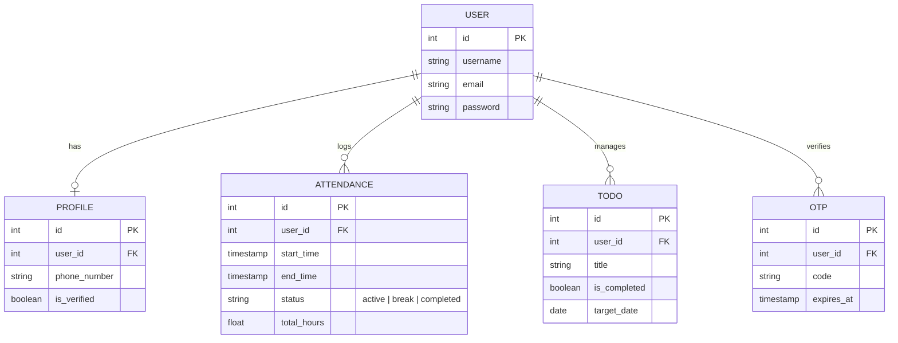
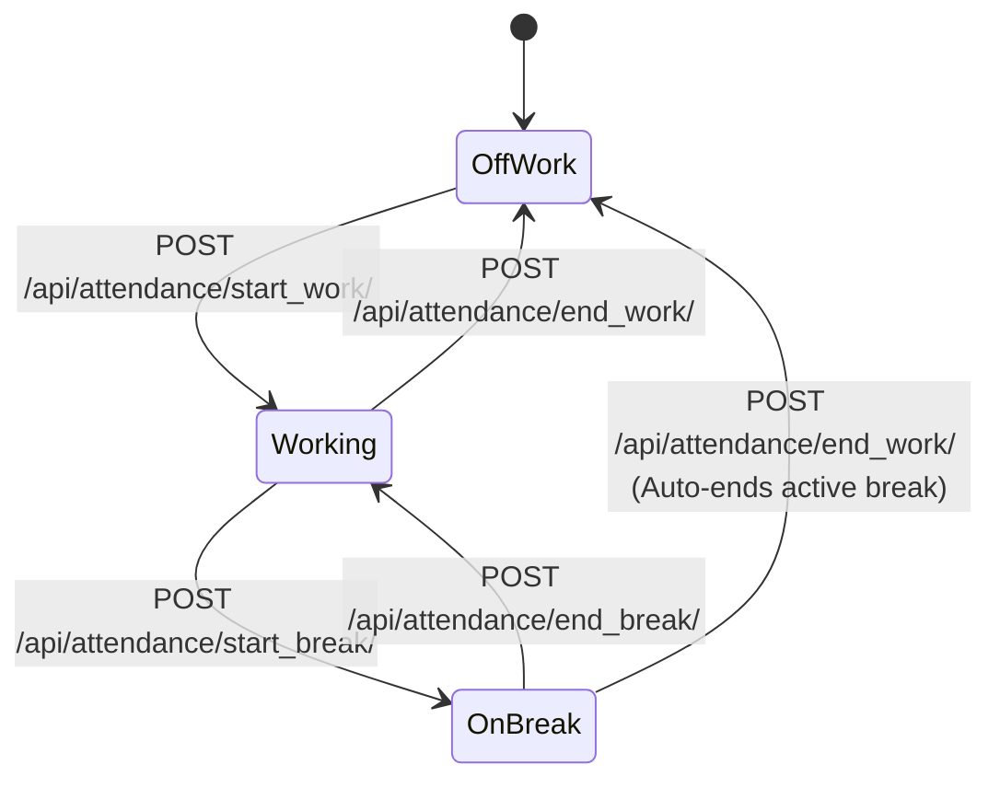

# System Architecture Document

This document provides a detailed overview of the system architecture, directory structures, database schema relationships, and logical data flows for the Tyqro platform.

---

## 1. Directory Structure

```
Tyqro/ (Root Workspace)
├── tyqro/                  # Django project settings & URL configuration
├── users/                  # User account management, registration, and OTP verification
├── attendance/             # Session tracking logs (work/break timers)
├── todos/                  # Task management (creation, deletion, checking)
├── analytics/              # Aggregated productivity data providers
├── notifications/          # Reminder systems & user alerts
├── frontend/               # React SPA SPA (Vite, Bootstrap, PWA)
│   ├── public/             # Service Worker (sw.js), web manifests, Favicon resources
│   └── src/
│       ├── components/     # AppLayout, AuthLayout, AnalogClock
│       ├── pages/          # Landing, Login, Signup, VerifyOTP, Dashboard
│       ├── App.jsx         # App routing and page state management
│       └── index.css       # Core stylesheets and dark/light themes
├── vercel.json             # Vercel Serverless hosting configuration
└── manage.py               # Django management CLI wrapper
```

---

## 2. Component Design & System Boundary

Tyqro adopts a **decoupled single-page application (SPA)** architecture, isolating the presentation layer (React) from the logic and data layers (Django REST Framework & PostgreSQL).

```mermaid
graph LR
    subgraph Client Application (Vercel Frontend)
        React[React SPA]
        SW[Service Worker Cache]
    end

    subgraph Service Layer (Vercel Serverless API)
        DRF[Django REST Framework]
        JWT[SimpleJWT Token Auth]
        OR[Django ORM]
    end

    subgraph Storage Layer (Supabase)
        DB[(PostgreSQL)]
    end

    React <-->|Network Requests / Bearer Token| DRF
    React <--> SW
    DRF <--> JWT
    DRF <--> OR
    OR <--> DB
```

---

## 3. Database Schema Design (Supabase PostgreSQL)



### 3.1. Schema Table Specifications
* **Auth & Profiles (`users` app)**: Extends Django’s standard `AbstractUser` to support stateless activation flags and automated profiling profiles.
* **Attendance Session Log (`attendance` app)**: Stores granular session timestamps. Status changes (`start_work`, `take_break`, `end_work`) write precise database intervals, calculating `total_hours` dynamically during completion.
* **Tasks (`todos` app)**: Links user identities with simple task records, tracked by a creation date string (`target_date`) to feed chronological dashboard metrics.

---

## 4. Attendance Session State Machine

To guarantee robust tracking without data loss across client refreshes or session crashes, the backend acts as the single source of truth for timer states.



1. **State Persistence**: The React frontend queries `/api/attendance/status/` on load to reconstruct the timer (`totalSeconds`), tracking running offsets since `start_time` or resuming break offsets instantly.
2. **Stateless Resumes**: JWT tokens are refreshed silently on background intervals. If a token expires, HTTP interceptors dispatch custom events to push users safely back to authorization wrappers.

---

## 5. Deployment and Hosting Strategy

* **Frontend Deploy (`vercel.json`)**: Configures rewrites to support clean single-page routes and serve service worker scripts under root scopes.
* **Serverless Backend Routing**: WSGI and serverless entry points route backend requests to DRF controllers, handling database pooling to Supabase to prevent execution limits.
