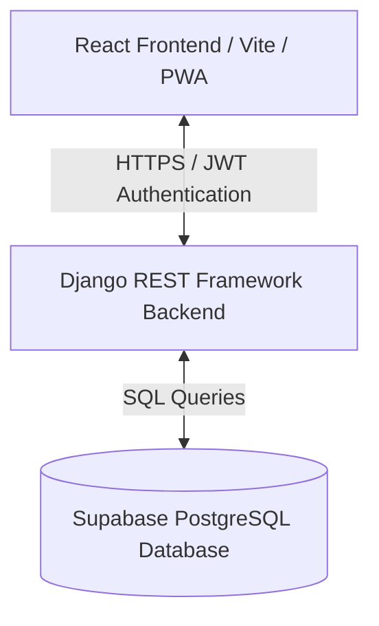

# Product Requirements Document (PRD)

## 1. Product Overview
**Tyqro** is a lightweight, high-performance time-tracking and productivity platform designed for freelancers, remote workers, and independent developers. The goal is to provide a clean, distraction-free interface combining granular session tracking (work/break), task list management, and visual productivity analytics without the bloat of traditional enterprise tracking suites.

---

## 2. Target Audience
* **Freelancers & Contract Workers**: Need precise work-session logs for invoicing.
* **Remote Employees**: Want simple dashboards to track daily attendance and breaks.
* **Solopreneurs & Developers**: Want to analyze task-completion performance alongside hours logged using calendar visual graphs.

---

## 3. Key Functional Features & Workflows

### 3.1. Authentication & Onboarding
* **Sign Up / Registration**: Secure signup using email, password, and personal details.
* **OTP Verification**: Multi-factor account activation using email-based One-Time Passwords (OTP).
* **JWT-Based Session Management**: Stateless authentication utilizing SimpleJWT tokens (`access_token` and `refresh_token`).
* **Password Recovery**: Secure OTP-based reset flows for forgot-password workflows.

### 3.2. Work Attendance & Session Tracking
* **Start / End Work**: Simple action toggling to initiate or end a work session, displaying a ticking digital clock simulation.
* **Break Management**: Dynamic pausing ("Take a Break") and resuming ("End Break") during active work sessions.
* **Stateless Tracking**: Sessions are saved and validated on the backend API. Tab closes/refreshes automatically sync timer states from current backend status logs.
* **Error Tolerant Operations**: Graceful handling of session overlap validation and state validation.

### 3.3. Daily Task Management (Todo List)
* **Creation**: Quickly add daily target tasks via a simple input interface.
* **Status Toggling**: Toggle completion state (strikethrough text decoration).
* **Metrics**: Real-time counter detailing the percentage/number of active versus completed tasks.

### 3.4. Performance Analytics (Heatmap)
* **Monthly Grouping (GeeksForGeeks Style)**: Visualizes historical activity (hours worked, tasks completed) across 12 distinct month blocks.
* **Isolate Boundaries**: Month grids only render cells that belong to their respective calendar month; dates from neighboring months are hidden to preserve accurate day counts per month block.
* **Interactive Tooltips**: Clickable grid cells that display the precise date, task completion ratio, and total hours logged for that specific date.

---

## 4. Technical Architecture & Stack

### 4.1. Frontend
* **Core**: React 18, Vite.
* **Styling**: Bootstrap 5 (CSS & Icons), Vanilla CSS for custom panels (support for Light and Dark modes).
* **PWA Capability**: Registers service workers (`sw.js`) utilizing Network-First cache strategies for instant offline capabilities and asset persistence.
* **Dynamic Themes**: Synchronized theme routing where the public landing page forces light-theme layouts, while auth sheets and the primary dashboard dynamically match dark/light modes.

### 4.2. Backend API
* **Core**: Django 5.x.
* **Framework**: Django REST Framework (DRF) for secure stateless API services.
* **Authentication**: Django SimpleJWT (`Bearer` Token header authorization).
* **CORS & CSRF Decoupling**: Configured trusted origins matching both localhost testing and Vercel cloud environments.

### 4.3. Infrastructure & Hosting
* **Database**: Supabase PostgreSQL.
* **Frontend Cloud Deploy**: Vercel (`tyqro.vercel.app`).
* **Backend API Deploy**: Vercel Serverless Function (`tyqro-api.vercel.app`).

---

## 5. Non-Functional Requirements

### 5.1. SEO Optimization
* **Meta Structuring**: Optimized page description tags, keyword structures, Twitter Card graphics, and Open Graph tags defined inside the main template.
* **Routing-aware Title Changes**: Title strings in browser tabs update dynamically on page transitions to assist indexing crawlers.
* **Crawler Directives**: Pre-configured `robots.txt` rules and XML sitemaps registered to assist search engine indexing.

### 5.2. Performance & Security
* **Asset Loading**: Split script chunks, lightweight typography engines (Inter), and compressed system assets.
* **Data Security**: Secure hashing algorithms for password records, token expiry guards, and strict CSRF boundaries on backend API operations.
