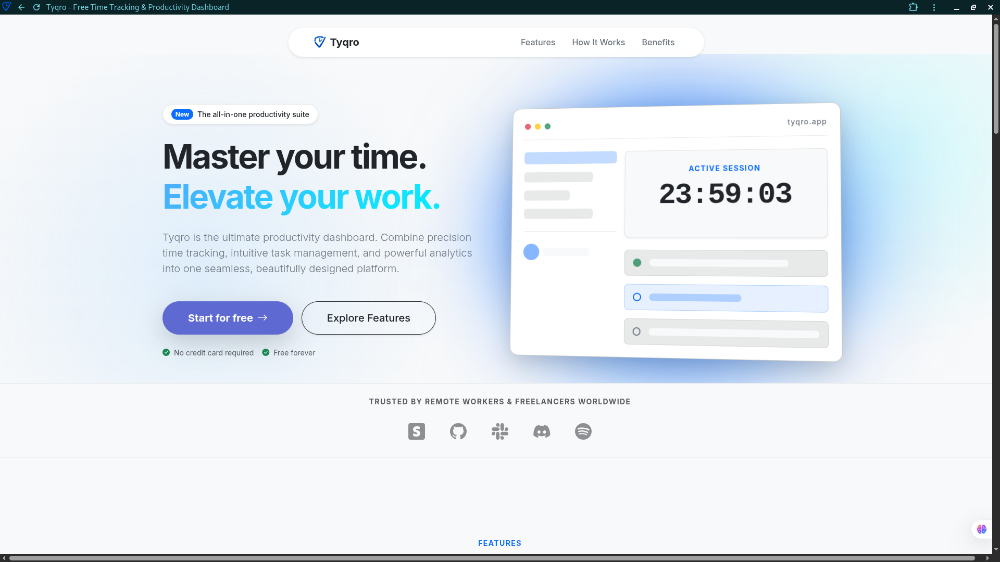

# Tyqro



Tyqro is a modern productivity and attendance tracking web application designed with a clean, Notion/Linear-inspired interface. It helps professionals manage their daily tasks while maintaining a robust, live-updating log of their work hours and performance.

---

## Key Features

*   **Dual Attendance Modes**:
    *   **Flexible Schedule (Default)**: Work toward a daily hour target (default 9 hours). Clock-in at any time without restriction, but prompt for an early-leave reason if logging out before the target is met.
    *   **Fixed Schedule**: Configure a custom Start and End time window. Requires a late-start reason if clocking in after your start time (+5 mins grace) and an early-leave reason if clocking out before your end time.
*   **Active Workdays Selection**: Custom workday selection defaults to all 7 days (Mon–Sun) on signup and can be updated individually.
*   **Robust Break System**: A live timer that allows users to go on break and resume work. Break durations are automatically deducted from the total work shift to record clean net work hours.
*   **Security & Password Toggles**: Sleek input groups on login, signup, password reset, and settings screens with a **Press-and-Hold to Reveal** (Microsoft-style) visibility toggle.
*   **Task Management (Todos)**: Fully AJAX-driven interactive todo list for creating, toggling, and deleting tasks without full page reloads.
*   **Performance Analytics Heatmap**: A GitHub-style yearly contribution graph powered by Chart.js, visualizing daily active hours, tasks completed, and points earned. Supports custom year-selection filters.
*   **Smart Automation**: Automatic monitoring checks to auto-close forgotten open sessions, auto-end shifts at 6:00 PM (for standard users), and daily push notifications.
*   **Performance Optimization**:
    *   **Asynchronous SMTP**: Runs all registration, email update, and password reset dispatches asynchronously using background worker threads, lowering wait times from seconds to sub-50ms.
    *   **Database Query Indexing**: Added a database index on the `Todo` date field to drastically speed up dashboard loads and analytics query times.

---

## Tech Stack

*   **Backend**: Django 5.x (Python)
*   **Database**: PostgreSQL (Supabase)
*   **Media Storage**: Cloudinary
*   **Hosting**: Vercel (Serverless)
*   **Frontend**: HTML5, Vanilla JavaScript, Bootstrap 5, Custom CSS
*   **Visualizations**: Chart.js

---

## Local Setup Instructions

1.  **Clone the repository** and navigate to the project root:
    ```bash
    cd Tyqro
    ```

2.  **Create and activate a virtual environment**:
    ```bash
    python -m venv venv
    source venv/bin/activate  # On Windows use: venv\Scripts\activate
    ```

3.  **Install dependencies**:
    ```bash
    pip install -r requirements.txt
    ```

4.  **Configure Environment Variables**:
    Create a `.env` file in the project root directory and define the following variables:
    ```env
    SECRET_KEY=your-django-secret-key
    DEBUG=True
    
    # Brevo SMTP details for email notifications
    EMAIL_HOST=smtp-relay.brevo.com
    EMAIL_PORT=587
    EMAIL_HOST_USER=your-email-host-user
    EMAIL_HOST_PASSWORD=your-email-password
    DEFAULT_FROM_EMAIL=your-from-email
    
    # Supabase Database & Cloudinary URL
    DATABASE_URL=postgresql://your-database-details
    CLOUDINARY_URL=cloudinary://your-cloudinary-details
    ```

5.  **Apply Database Migrations**:
    ```bash
    python manage.py migrate
    ```

6.  **Create a Superuser** (to access the Django Admin panel):
    ```bash
    python manage.py createsuperuser
    ```

7.  **Run the Development Server**:
    ```bash
    python manage.py runserver
    ```

8.  **Access the Application**:
    Open [http://127.0.0.1:8000/](http://127.0.0.1:8000/) in your browser.
