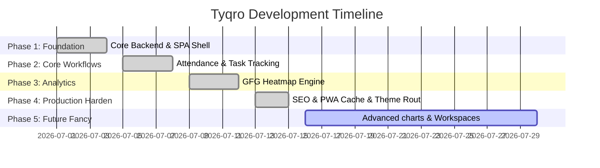

# Project Development Phases & Roadmap

This document outlines the execution phases of the Tyqro project, capturing both the **Completed Milestones** that form the current system and the **Fancy Future Enhancements** planned for upcoming release cycles.

---

## Roadmap Overview

---

## Detailed Phases

### Phase 1: Architecture & Foundation (Completed ✅)
* **Backend Shell**: Python/Django structure configured for DRF and token authentication rules.
* **Database Pipeline**: Supabase PostgreSQL database integration.
* **Stateless Authentication**: SimpleJWT implementation protecting endpoints using standard token auth schemas.
* **Frontend SPA Core**: React SPA initialized with Vite and styled via Bootstrap 5.

### Phase 2: Attendance & Daily Workflows (Completed ✅)
* **Attendance Session Management**: State machines handling session workflows (`start_work`, `take_break`, `end_work`).
* **Active State Resume**: Real-time frontend timer synchronizes directly with backend time offsets on tab load/refresh.
* **Daily Todo Lists**: Lightweight task list interface providing quick adds, checking states, and active todo counts.

### Phase 3: Productivity Analytics (Completed ✅)
* **GFG-Style Heatmap Engine**: Calendar rendering engine grouping weeks into 12 distinct monthly blocks with visual gaps.
* **Month Grid Isolation**: Implements strict boundary checking; cells outside the active month's calendar are hidden to prevent day-count leakage.
* **Interaction Layer**: Tooltips showing granular history (total hours worked, tasks completed/total ratio) when tapping grid cells.

### Phase 4: Production Hardening & SEO (Completed ✅)
* **SEO Metadata**: Enforces primary description tags, keywords, Twitter card details, and Open Graph previews.
* **Robots & Sitemap**: Active registration of indexing guides (`robots.txt` and `sitemap.xml`) inside the public directory.
* **Service Worker Integration**: Registers `sw.js` supporting offline functionality and local caches.
* **Centralized Theme Routing**: Automatically switches document themes to match layouts:
  * Public landing pages force a clean **Light Theme**.
  * Auth screens and primary user dashboards default to **Dark Theme**.

### Phase 5: Advanced Analytics & Teams (Upcoming/Fancy 🚀)
* **Granular Charts & Reports**: Introduce ApexCharts/Recharts displaying categories of tasks worked versus total logged hours in bar/pie graphs.
* **Shared Workspaces & Teams**:
  * Create workspaces allowing team leads to invite members.
  * Roll out team attendance grids and shared progress feeds.
* **Time Categorization**: Assign logged sessions to specific projects/labels to track time distribution metrics.
* **Pomodoro Integration**: Optional focus timers syncing active intervals with breaks automatically.
* **Third-Party Calendar Integration**: Secure exports to Google Calendar, Outlook, or Slack status updates.
